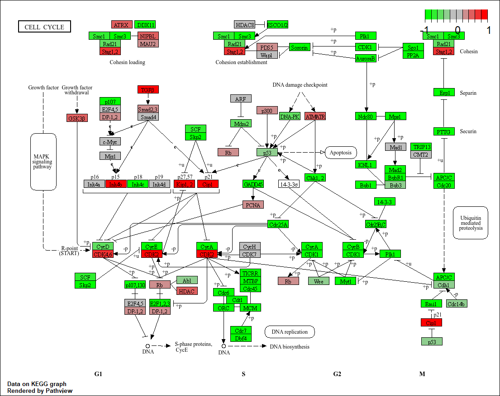
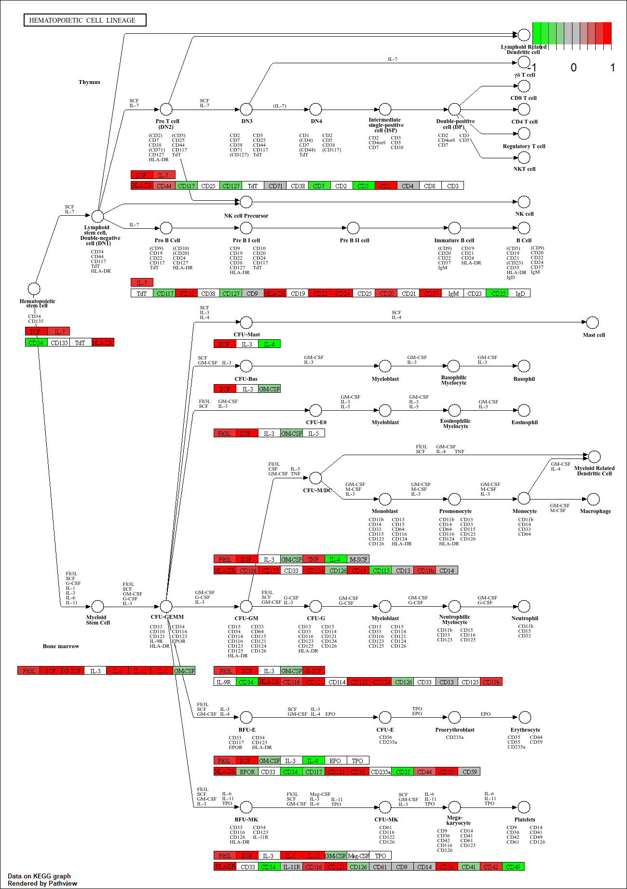
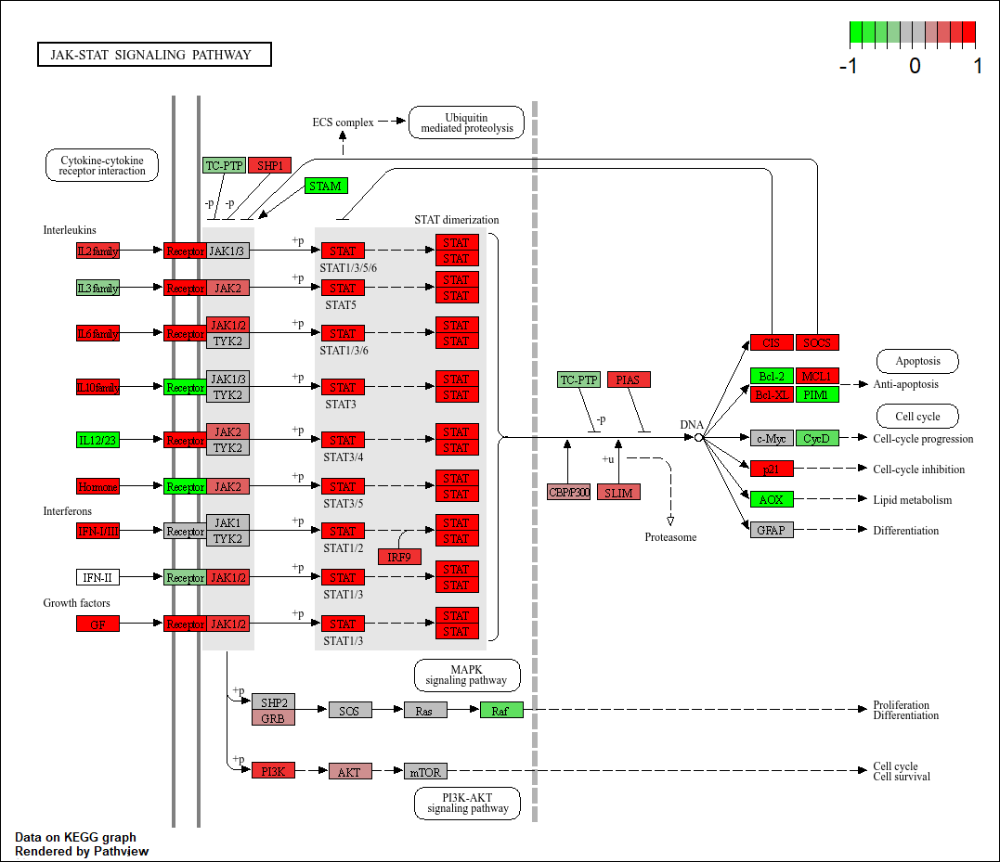
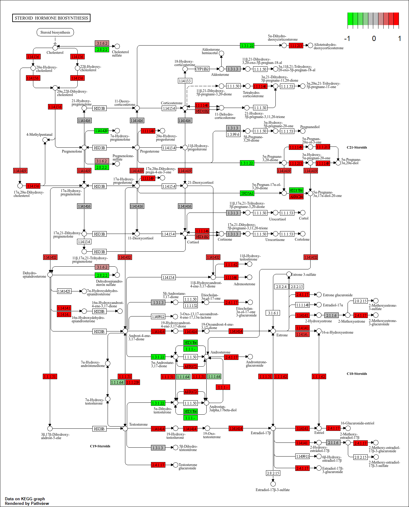
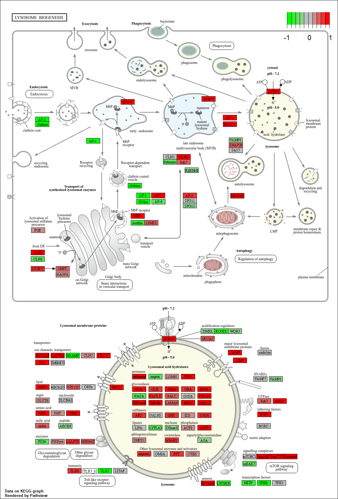
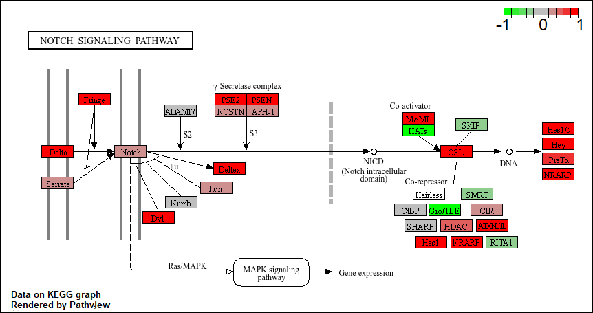
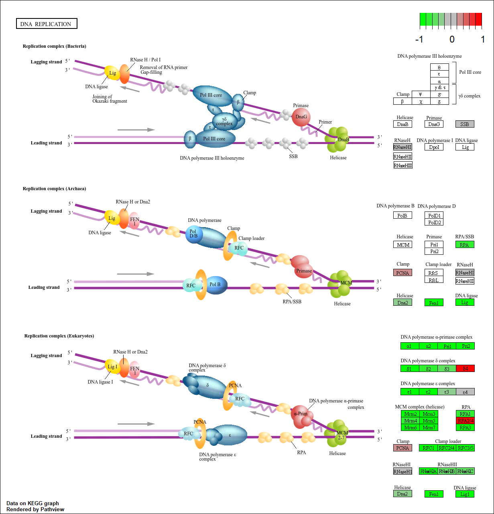
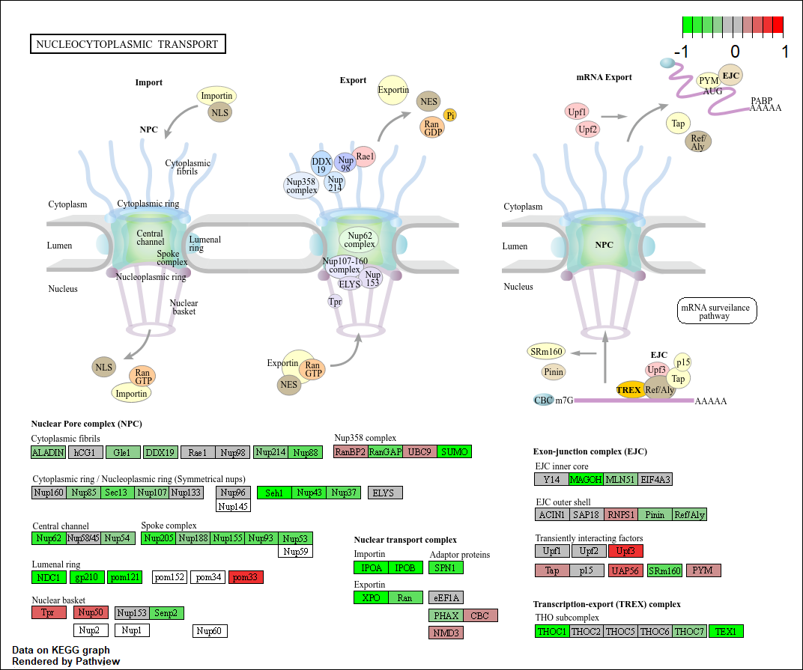
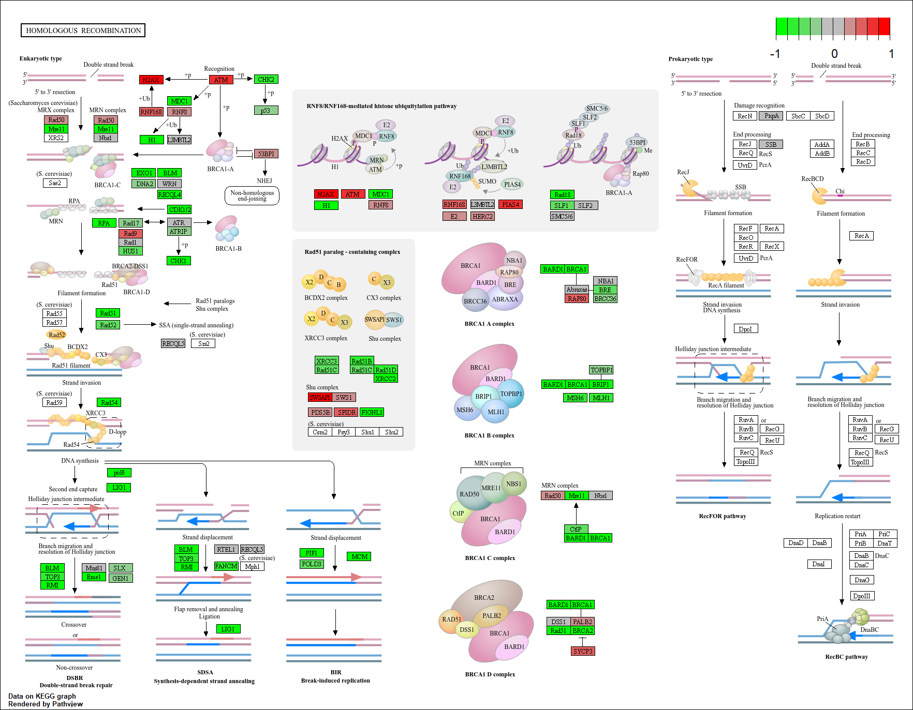
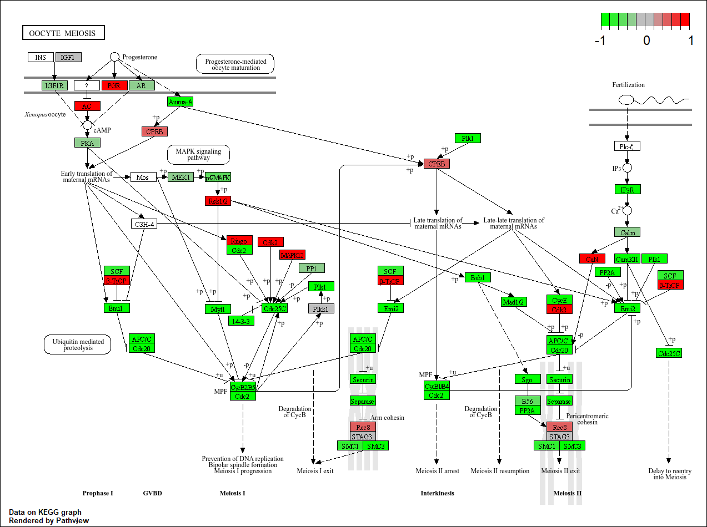

# Class 14
Jingxuan Wu A18624595

# Section 1. Differential Expression Analysis

## Load required packages

``` r
library(DESeq2)
```

    Loading required package: S4Vectors

    Loading required package: stats4

    Loading required package: BiocGenerics

    Loading required package: generics

    Attaching package: 'generics'

    The following objects are masked from 'package:base':

        as.difftime, as.factor, as.ordered, intersect, is.element, setdiff,
        setequal, union

    Attaching package: 'BiocGenerics'

    The following objects are masked from 'package:stats':

        IQR, mad, sd, var, xtabs

    The following objects are masked from 'package:base':

        anyDuplicated, aperm, append, as.data.frame, basename, cbind,
        colnames, dirname, do.call, duplicated, eval, evalq, Filter, Find,
        get, grep, grepl, is.unsorted, lapply, Map, mapply, match, mget,
        order, paste, pmax, pmax.int, pmin, pmin.int, Position, rank,
        rbind, Reduce, rownames, sapply, saveRDS, table, tapply, unique,
        unsplit, which.max, which.min

    Attaching package: 'S4Vectors'

    The following object is masked from 'package:utils':

        findMatches

    The following objects are masked from 'package:base':

        expand.grid, I, unname

    Loading required package: IRanges

    Attaching package: 'IRanges'

    The following object is masked from 'package:grDevices':

        windows

    Loading required package: GenomicRanges

    Loading required package: Seqinfo

    Loading required package: SummarizedExperiment

    Loading required package: MatrixGenerics

    Loading required package: matrixStats

    Warning: package 'matrixStats' was built under R version 4.6.2

    Attaching package: 'MatrixGenerics'

    The following objects are masked from 'package:matrixStats':

        colAlls, colAnyNAs, colAnys, colAvgsPerRowSet, colCollapse,
        colCounts, colCummaxs, colCummins, colCumprods, colCumsums,
        colDiffs, colIQRDiffs, colIQRs, colLogSumExps, colMadDiffs,
        colMads, colMaxs, colMeans2, colMedians, colMins, colOrderStats,
        colProds, colQuantiles, colRanges, colRanks, colSdDiffs, colSds,
        colSums2, colTabulates, colVarDiffs, colVars, colWeightedMads,
        colWeightedMeans, colWeightedMedians, colWeightedSds,
        colWeightedVars, rowAlls, rowAnyNAs, rowAnys, rowAvgsPerColSet,
        rowCollapse, rowCounts, rowCummaxs, rowCummins, rowCumprods,
        rowCumsums, rowDiffs, rowIQRDiffs, rowIQRs, rowLogSumExps,
        rowMadDiffs, rowMads, rowMaxs, rowMeans2, rowMedians, rowMins,
        rowOrderStats, rowProds, rowQuantiles, rowRanges, rowRanks,
        rowSdDiffs, rowSds, rowSums2, rowTabulates, rowVarDiffs, rowVars,
        rowWeightedMads, rowWeightedMeans, rowWeightedMedians,
        rowWeightedSds, rowWeightedVars

    Loading required package: Biobase

    Welcome to Bioconductor

        Vignettes contain introductory material; view with
        'browseVignettes()'. To cite Bioconductor, see
        'citation("Biobase")', and for packages 'citation("pkgname")'.

    Attaching package: 'Biobase'

    The following object is masked from 'package:MatrixGenerics':

        rowMedians

    The following objects are masked from 'package:matrixStats':

        anyMissing, rowMedians

``` r
library(ggplot2)
```

    Warning: package 'ggplot2' was built under R version 4.6.2

``` r
library(AnnotationDbi)
library(org.Hs.eg.db)
```

## Import count data and metadata

``` r
dir.create("data", showWarnings = FALSE)

metaFile <- "data/GSE37704_metadata.csv"
countFile <- "data/GSE37704_featurecounts.csv"

if (!file.exists(metaFile)) {
  download.file(
    "https://bioboot.github.io/bimm143_W18/class-material/GSE37704_metadata.csv",
    destfile = metaFile,
    mode = "wb"
  )
}

if (!file.exists(countFile)) {
  download.file(
    "https://bioboot.github.io/bimm143_W18/class-material/GSE37704_featurecounts.csv",
    destfile = countFile,
    mode = "wb"
  )
}

colData <- read.csv(metaFile, row.names = 1)
head(colData)
```

                  condition
    SRR493366 control_sirna
    SRR493367 control_sirna
    SRR493368 control_sirna
    SRR493369      hoxa1_kd
    SRR493370      hoxa1_kd
    SRR493371      hoxa1_kd

``` r
countData <- read.csv(countFile, row.names = 1)
head(countData)
```

                    length SRR493366 SRR493367 SRR493368 SRR493369 SRR493370
    ENSG00000186092    918         0         0         0         0         0
    ENSG00000279928    718         0         0         0         0         0
    ENSG00000279457   1982        23        28        29        29        28
    ENSG00000278566    939         0         0         0         0         0
    ENSG00000273547    939         0         0         0         0         0
    ENSG00000187634   3214       124       123       205       207       212
                    SRR493371
    ENSG00000186092         0
    ENSG00000279928         0
    ENSG00000279457        46
    ENSG00000278566         0
    ENSG00000273547         0
    ENSG00000187634       258

## Question 1. Remove the first column from countData

``` r
# Remove the length column, leaving only sample counts.
countData <- as.matrix(countData[, -1, drop = FALSE])
head(countData)
```

                    SRR493366 SRR493367 SRR493368 SRR493369 SRR493370 SRR493371
    ENSG00000186092         0         0         0         0         0         0
    ENSG00000279928         0         0         0         0         0         0
    ENSG00000279457        23        28        29        29        28        46
    ENSG00000278566         0         0         0         0         0         0
    ENSG00000273547         0         0         0         0         0         0
    ENSG00000187634       124       123       205       207       212       258

**Answer:** The first column contains gene lengths, not read counts.
Removing it leaves a count matrix whose columns correspond to the six
RNA-seq samples.

## Question 2. Filter out genes with zero counts

``` r
# rowSums(countData) returns the total read count for each gene.
countData <- countData[rowSums(countData) > 0, , drop = FALSE]
head(countData)
```

                    SRR493366 SRR493367 SRR493368 SRR493369 SRR493370 SRR493371
    ENSG00000279457        23        28        29        29        28        46
    ENSG00000187634       124       123       205       207       212       258
    ENSG00000188976      1637      1831      2383      1226      1326      1504
    ENSG00000187961       120       153       180       236       255       357
    ENSG00000187583        24        48        65        44        48        64
    ENSG00000187642         4         9        16        14        16        16

``` r
cat("Genes remaining after filtering:", nrow(countData), "\n")
```

    Genes remaining after filtering: 15975 

**Answer:** `rowSums(countData)` calculates the total number of reads
for each gene across all samples. The condition `> 0` keeps genes with
at least one observed read and removes genes that have zero counts
everywhere.

## Run DESeq2

``` r
# Ensure countData columns and colData rows represent the same samples.
stopifnot(all(colnames(countData) %in% rownames(colData)))
colData <- colData[colnames(countData), , drop = FALSE]

# Set the control as the reference group.
colData$condition <- factor(
  colData$condition,
  levels = c("control_sirna", "hoxa1_kd")
)

# Construct the DESeqDataSet and run differential expression analysis.
dds <- DESeqDataSetFromMatrix(
  countData = countData,
  colData = colData,
  design = ~ condition
)

dds <- DESeq(dds)
```

    estimating size factors

    estimating dispersions

    gene-wise dispersion estimates

    mean-dispersion relationship

    final dispersion estimates

    fitting model and testing

``` r
dds
```

    class: DESeqDataSet 
    dim: 15975 6 
    metadata(1): version
    assays(4): counts mu H cooks
    rownames(15975): ENSG00000279457 ENSG00000187634 ... ENSG00000276345
      ENSG00000271254
    rowData names(22): baseMean baseVar ... deviance maxCooks
    colnames(6): SRR493366 SRR493367 ... SRR493370 SRR493371
    colData names(2): condition sizeFactor

## Obtain HOXA1 knockdown versus control results

``` r
resultsNames(dds)
```

    [1] "Intercept"                           "condition_hoxa1_kd_vs_control_sirna"

``` r
res <- results(
  dds,
  contrast = c("condition", "hoxa1_kd", "control_sirna")
)
head(res)
```

    log2 fold change (MLE): condition hoxa1_kd vs control_sirna 
    Wald test p-value: condition hoxa1 kd vs control sirna 
    DataFrame with 6 rows and 6 columns
                     baseMean log2FoldChange     lfcSE       stat      pvalue
                    <numeric>      <numeric> <numeric>  <numeric>   <numeric>
    ENSG00000279457   29.9136      0.1792571 0.3248216   0.551863 5.81042e-01
    ENSG00000187634  183.2296      0.4264571 0.1402658   3.040350 2.36304e-03
    ENSG00000188976 1651.1881     -0.6927205 0.0548465 -12.630158 1.43990e-36
    ENSG00000187961  209.6379      0.7297556 0.1318599   5.534326 3.12428e-08
    ENSG00000187583   47.2551      0.0405765 0.2718928   0.149237 8.81366e-01
    ENSG00000187642   11.9798      0.5428105 0.5215598   1.040744 2.97994e-01
                           padj
                      <numeric>
    ENSG00000279457 6.86555e-01
    ENSG00000187634 5.15718e-03
    ENSG00000188976 1.76549e-35
    ENSG00000187961 1.13413e-07
    ENSG00000187583 9.19031e-01
    ENSG00000187642 4.03379e-01

## Question 3. Summarize differential expression results

``` r
summary(res)
```

    out of 15975 with nonzero total read count
    adjusted p-value < 0.1
    LFC > 0 (up)       : 4349, 27%
    LFC < 0 (down)     : 4396, 28%
    outliers [1]       : 0, 0%
    low counts [2]     : 1237, 7.7%
    (mean count < 0)
    [1] see 'cooksCutoff' argument of ?results
    [2] see 'independentFiltering' argument of ?results

``` r
n_up <- sum(
  !is.na(res$padj) & res$padj < 0.1 & res$log2FoldChange > 0
)
n_down <- sum(
  !is.na(res$padj) & res$padj < 0.1 & res$log2FoldChange < 0
)
```

**Answer:** At an adjusted p-value cutoff of 0.1, there are **4349**
upregulated genes and **4396** downregulated genes in HOXA1 knockdown
relative to control. These counts are calculated from the current DESeq2
results.

## Volcano Plot

``` r
res_df <- as.data.frame(res)

ggplot(res_df, aes(x = log2FoldChange, y = -log(padj))) +
  geom_point(size = 0.6, na.rm = TRUE) +
  xlab("Log2(FoldChange)") +
  ylab("-Log(P-value)")
```


## Question 4. Improve the volcano plot

``` r
# Make a color vector for all genes.
mycols <- rep("gray", nrow(res))

# Color blue the genes with absolute log2 fold change above 2.
mycols[which(abs(res$log2FoldChange) > 2)] <- "blue"

# Color gray the genes with adjusted p-values greater than 0.01.
mycols[which(res$padj > 0.01)] <- "gray"

# Add the colors to the data frame so each point keeps the correct color.
res_df$mycols <- mycols

ggplot(res_df, aes(x = log2FoldChange, y = -log(padj))) +
  geom_point(aes(color = mycols), size = 0.6, na.rm = TRUE) +
  scale_color_identity() +
  xlab("Log2(FoldChange)") +
  ylab("-Log(P-value)") +
  geom_vline(xintercept = c(-2, 2)) +
  geom_hline(yintercept = -log(0.01))
```


**Answer:** Blue points represent genes with `|log2FoldChange| > 2` and
`padj <= 0.01`. Gray points do not satisfy both thresholds. The vertical
lines mark log2 fold changes of -2 and +2, while the horizontal line
marks an adjusted p-value of 0.01.

## Question 5. Add gene annotation

``` r
# Inspect available types of gene annotation.
head(columns(org.Hs.eg.db), 20)
```

     [1] "ACCNUM"       "ALIAS"        "ENSEMBL"      "ENSEMBLPROT"  "ENSEMBLTRANS"
     [6] "ENTREZID"     "ENZYME"       "EVIDENCE"     "EVIDENCEALL"  "GENENAME"    
    [11] "GENETYPE"     "GO"           "GOALL"        "IPI"          "MAP"         
    [16] "OMIM"         "ONTOLOGY"     "ONTOLOGYALL"  "PATH"         "PFAM"        

``` r
res$symbol <- mapIds(
  org.Hs.eg.db,
  keys = rownames(res),
  keytype = "ENSEMBL",
  column = "SYMBOL",
  multiVals = "first"
)
```

    'select()' returned 1:many mapping between keys and columns

``` r
res$entrez <- mapIds(
  org.Hs.eg.db,
  keys = rownames(res),
  keytype = "ENSEMBL",
  column = "ENTREZID",
  multiVals = "first"
)
```

    'select()' returned 1:many mapping between keys and columns

``` r
res$name <- mapIds(
  org.Hs.eg.db,
  keys = rownames(res),
  keytype = "ENSEMBL",
  column = "GENENAME",
  multiVals = "first"
)
```

    'select()' returned 1:many mapping between keys and columns

``` r
head(res, 10)
```

    log2 fold change (MLE): condition hoxa1_kd vs control_sirna 
    Wald test p-value: condition hoxa1 kd vs control sirna 
    DataFrame with 10 rows and 9 columns
                       baseMean log2FoldChange     lfcSE       stat      pvalue
                      <numeric>      <numeric> <numeric>  <numeric>   <numeric>
    ENSG00000279457   29.913579      0.1792571 0.3248216   0.551863 5.81042e-01
    ENSG00000187634  183.229650      0.4264571 0.1402658   3.040350 2.36304e-03
    ENSG00000188976 1651.188076     -0.6927205 0.0548465 -12.630158 1.43990e-36
    ENSG00000187961  209.637938      0.7297556 0.1318599   5.534326 3.12428e-08
    ENSG00000187583   47.255123      0.0405765 0.2718928   0.149237 8.81366e-01
    ENSG00000187642   11.979750      0.5428105 0.5215598   1.040744 2.97994e-01
    ENSG00000188290  108.922128      2.0570638 0.1969053  10.446970 1.51282e-25
    ENSG00000187608  350.716868      0.2573837 0.1027266   2.505522 1.22271e-02
    ENSG00000188157 9128.439422      0.3899088 0.0467163   8.346304 7.04321e-17
    ENSG00000237330    0.158192      0.7859552 4.0804729   0.192614 8.47261e-01
                           padj      symbol      entrez                   name
                      <numeric> <character> <character>            <character>
    ENSG00000279457 6.86555e-01          NA          NA                     NA
    ENSG00000187634 5.15718e-03      SAMD11      148398 sterile alpha motif ..
    ENSG00000188976 1.76549e-35       NOC2L       26155 NOC2 like nucleolar ..
    ENSG00000187961 1.13413e-07      KLHL17      339451 kelch like family me..
    ENSG00000187583 9.19031e-01     PLEKHN1       84069 pleckstrin homology ..
    ENSG00000187642 4.03379e-01       PERM1       84808 PPARGC1 and ESRR ind..
    ENSG00000188290 1.30538e-24        HES4       57801 hes family bHLH tran..
    ENSG00000187608 2.37452e-02       ISG15        9636 ISG15 ubiquitin like..
    ENSG00000188157 4.21963e-16        AGRN      375790                  agrin
    ENSG00000237330          NA      RNF223      401934 ring finger protein ..

**Answer:** The `mapIds()` function converts Ensembl gene IDs into gene
symbols, Entrez gene IDs, and descriptive gene names. Entrez IDs are
useful for the downstream KEGG pathway analysis. Some genes may have
missing annotations (`NA`).

## Question 6. Sort results and export a CSV file

``` r
# Sort by adjusted p-value, with missing values at the end.
res <- res[order(res$padj, na.last = TRUE), ]

# Export the complete annotated results table.
write.csv(
  as.data.frame(res),
  file = "deseq_results.csv",
  row.names = TRUE
)

head(res, 10)
```

    log2 fold change (MLE): condition hoxa1_kd vs control_sirna 
    Wald test p-value: condition hoxa1 kd vs control sirna 
    DataFrame with 10 rows and 9 columns
                     baseMean log2FoldChange     lfcSE      stat    pvalue
                    <numeric>      <numeric> <numeric> <numeric> <numeric>
    ENSG00000117519   4483.63       -2.42272 0.0600016  -40.3776         0
    ENSG00000183508   2053.88        3.20196 0.0724172   44.2154         0
    ENSG00000159176   5692.46       -2.31374 0.0575534  -40.2016         0
    ENSG00000116016   4423.95       -1.88802 0.0431680  -43.7366         0
    ENSG00000164251   2348.77        3.34451 0.0690718   48.4208         0
    ENSG00000124766   2576.65        2.39229 0.0617086   38.7675         0
    ENSG00000124762  28106.12        1.83226 0.0388966   47.1058         0
    ENSG00000106366  43719.13       -1.84405 0.0419165  -43.9933         0
    ENSG00000188153   2944.13        2.26608 0.0552681   41.0016         0
    ENSG00000122861  28007.14        2.26253 0.0552183   40.9742         0
                         padj      symbol      entrez                   name
                    <numeric> <character> <character>            <character>
    ENSG00000117519         0        CNN3        1266             calponin 3
    ENSG00000183508         0      TENT5C       54855 terminal nucleotidyl..
    ENSG00000159176         0       CSRP1        1465 cysteine and glycine..
    ENSG00000116016         0       EPAS1        2034 endothelial PAS doma..
    ENSG00000164251         0       F2RL1        2150 F2R like trypsin rec..
    ENSG00000124766         0        SOX4        6659 SRY-box transcriptio..
    ENSG00000124762         0      CDKN1A        1026 cyclin dependent kin..
    ENSG00000106366         0    SERPINE1        5054 serpin family E memb..
    ENSG00000188153         0      COL4A5        1287 collagen type IV alp..
    ENSG00000122861         0        PLAU        5328 plasminogen activato..

``` r
file.exists("deseq_results.csv")
```

    [1] TRUE

**Answer:** The results are sorted from the smallest to the largest
adjusted p-value, putting genes with the strongest statistical evidence
first. The file `deseq_results.csv` contains the differential expression
results and gene annotations, with Ensembl IDs preserved as row names.

# Section 2. Pathway Analysis

## Load KEGG Gene Sets

``` r
library(pathview)
```

    ##############################################################################
    Pathview is an open source software package distributed under GNU General
    Public License version 3 (GPLv3). Details of GPLv3 is available at
    http://www.gnu.org/licenses/gpl-3.0.html. Particullary, users are required to
    formally cite the original Pathview paper (not just mention it) in publications
    or products. For details, do citation("pathview") within R.

    The pathview downloads and uses KEGG data. Non-academic uses may require a KEGG
    license agreement (details at http://www.kegg.jp/kegg/legal.html).
    ##############################################################################

``` r
library(gage)
```

``` r
library(gageData)

data(kegg.sets.hs)
data(sigmet.idx.hs)

# Focus on signaling and metabolic pathways.
kegg.sets.hs <- kegg.sets.hs[sigmet.idx.hs]

length(kegg.sets.hs)
```

    [1] 177

``` r
head(kegg.sets.hs, 3)
```

    $`hsa00232 Caffeine metabolism`
    [1] "10"   "1544" "1548" "1549" "1553" "7498" "9"   

    $`hsa00983 Drug metabolism - other enzymes`
     [1] "10"     "1066"   "10720"  "10941"  "151531" "1548"   "1549"   "1551"  
     [9] "1553"   "1576"   "1577"   "1806"   "1807"   "1890"   "221223" "2990"  
    [17] "3251"   "3614"   "3615"   "3704"   "51733"  "54490"  "54575"  "54576" 
    [25] "54577"  "54578"  "54579"  "54600"  "54657"  "54658"  "54659"  "54963" 
    [33] "574537" "64816"  "7083"   "7084"   "7172"   "7363"   "7364"   "7365"  
    [41] "7366"   "7367"   "7371"   "7372"   "7378"   "7498"   "79799"  "83549" 
    [49] "8824"   "8833"   "9"      "978"   

    $`hsa00230 Purine metabolism`
      [1] "100"    "10201"  "10606"  "10621"  "10622"  "10623"  "107"    "10714" 
      [9] "108"    "10846"  "109"    "111"    "11128"  "11164"  "112"    "113"   
     [17] "114"    "115"    "122481" "122622" "124583" "132"    "158"    "159"   
     [25] "1633"   "171568" "1716"   "196883" "203"    "204"    "205"    "221823"
     [33] "2272"   "22978"  "23649"  "246721" "25885"  "2618"   "26289"  "270"   
     [41] "271"    "27115"  "272"    "2766"   "2977"   "2982"   "2983"   "2984"  
     [49] "2986"   "2987"   "29922"  "3000"   "30833"  "30834"  "318"    "3251"  
     [57] "353"    "3614"   "3615"   "3704"   "377841" "471"    "4830"   "4831"  
     [65] "4832"   "4833"   "4860"   "4881"   "4882"   "4907"   "50484"  "50940" 
     [73] "51082"  "51251"  "51292"  "5136"   "5137"   "5138"   "5139"   "5140"  
     [81] "5141"   "5142"   "5143"   "5144"   "5145"   "5146"   "5147"   "5148"  
     [89] "5149"   "5150"   "5151"   "5152"   "5153"   "5158"   "5167"   "5169"  
     [97] "51728"  "5198"   "5236"   "5313"   "5315"   "53343"  "54107"  "5422"  
    [105] "5424"   "5425"   "5426"   "5427"   "5430"   "5431"   "5432"   "5433"  
    [113] "5434"   "5435"   "5436"   "5437"   "5438"   "5439"   "5440"   "5441"  
    [121] "5471"   "548644" "55276"  "5557"   "5558"   "55703"  "55811"  "55821" 
    [129] "5631"   "5634"   "56655"  "56953"  "56985"  "57804"  "58497"  "6240"  
    [137] "6241"   "64425"  "646625" "654364" "661"    "7498"   "8382"   "84172" 
    [145] "84265"  "84284"  "84618"  "8622"   "8654"   "87178"  "8833"   "9060"  
    [153] "9061"   "93034"  "953"    "9533"   "954"    "955"    "956"    "957"   
    [161] "9583"   "9615"  

## Prepare a Named Fold-Change Vector

``` r
# Extract log2 fold changes.
foldchanges <- res$log2FoldChange

# Use Entrez IDs as names.
names(foldchanges) <- res$entrez

# Remove missing values and missing IDs.
valid <- is.finite(foldchanges) &
  !is.na(names(foldchanges)) &
  nzchar(names(foldchanges))

foldchanges <- foldchanges[valid]

# Remove duplicate Entrez identifiers.
foldchanges <- foldchanges[
  !duplicated(names(foldchanges))
]

head(foldchanges)
```

         1266     54855      1465      2034      2150      6659 
    -2.422719  3.201955 -2.313738 -1.888019  3.344508  2.392288 

## Run GAGE Enrichment Analysis

``` r
keggres <- gage(
  foldchanges,
  gsets = kegg.sets.hs,
  same.dir = TRUE
)

attributes(keggres)
```

    $names
    [1] "greater" "less"    "stats"  

``` r
head(keggres$greater)
```

                                            p.geomean stat.mean       p.val
    hsa04640 Hematopoietic cell lineage   0.002761660  2.840986 0.002761660
    hsa04630 Jak-STAT signaling pathway   0.005027429  2.597816 0.005027429
    hsa00140 Steroid hormone biosynthesis 0.007145525  2.532766 0.007145525
    hsa04142 Lysosome                     0.009728205  2.352963 0.009728205
    hsa04330 Notch signaling pathway      0.018339543  2.121062 0.018339543
    hsa04916 Melanogenesis                0.018870291  2.093511 0.018870291
                                              q.val set.size        exp1
    hsa04640 Hematopoietic cell lineage   0.3834765       55 0.002761660
    hsa04630 Jak-STAT signaling pathway   0.3834765      109 0.005027429
    hsa00140 Steroid hormone biosynthesis 0.3834765       31 0.007145525
    hsa04142 Lysosome                     0.3915603      118 0.009728205
    hsa04330 Notch signaling pathway      0.4323975       46 0.018339543
    hsa04916 Melanogenesis                0.4323975       90 0.018870291

``` r
head(keggres$less)
```

                                             p.geomean stat.mean        p.val
    hsa04110 Cell cycle                   9.449903e-06 -4.367030 9.449903e-06
    hsa03030 DNA replication              9.645085e-05 -3.944914 9.645085e-05
    hsa03013 RNA transport                1.453444e-03 -3.011183 1.453444e-03
    hsa03440 Homologous recombination     3.116689e-03 -2.846967 3.116689e-03
    hsa04114 Oocyte meiosis               3.909792e-03 -2.686870 3.909792e-03
    hsa00010 Glycolysis / Gluconeogenesis 9.161054e-03 -2.396875 9.161054e-03
                                                q.val set.size         exp1
    hsa04110 Cell cycle                   0.001521434      121 9.449903e-06
    hsa03030 DNA replication              0.007764293       36 9.645085e-05
    hsa03013 RNA transport                0.078001491      144 1.453444e-03
    hsa03440 Homologous recombination     0.125446728       28 3.116689e-03
    hsa04114 Oocyte meiosis               0.125895290      102 3.909792e-03
    hsa00010 Glycolysis / Gluconeogenesis 0.214475680       53 9.161054e-03

## Identify the Top Downregulated Pathway

``` r
top_down_pathway <- rownames(keggres$less)[1]

top_down_id <- substr(
  top_down_pathway,
  1,
  8
)

top_down_pathway
```

    [1] "hsa04110 Cell cycle"

``` r
top_down_id
```

    [1] "hsa04110"

## Plot the Cell Cycle Pathway

``` r
pv_cell <- pathview(
  gene.data = foldchanges,
  pathway.id = "hsa04110",
  species = "hsa",
  out.suffix = "cell_cycle"
)
```

    'select()' returned 1:1 mapping between keys and columns

    Info: Working in directory D:/bimm143/Class14

    Info: Writing image file hsa04110.cell_cycle.png



## Graphviz PDF Version of Cell Cycle (Optional)

``` r
tryCatch(
  pathview(
    gene.data = foldchanges,
    pathway.id = "hsa04110",
    species = "hsa",
    kegg.native = FALSE,
    out.suffix = "cell_cycle_vector"
  ),
  error = function(e) {
    message(
      "Optional Graphviz diagram unavailable: ",
      conditionMessage(e)
    )
  }
)
```

    'select()' returned 1:1 mapping between keys and columns

    Warning: reconcile groups sharing member nodes!

    Info: Working in directory D:/bimm143/Class14

    Info: Writing image file hsa04110.cell_cycle_vector.pdf

    Warning in text.default(xloc, yloc, label = labs[sub2grp[sub.idx, 1]], cex = cex): length(labels) > max(length(x), length(y));
    'labels' truncated to length 36

<embed src="hsa04110.cell_cycle_vector.pdf" style="width:95.0%" />

## Top Five Upregulated KEGG Pathways

``` r
# Extract the top five upregulated pathways.
keggrespathways <- head(
  rownames(keggres$greater),
  5
)

# Extract KEGG pathway IDs.
keggresids <- substr(
  keggrespathways,
  start = 1,
  stop = 8
)

keggrespathways
```

    [1] "hsa04640 Hematopoietic cell lineage"  
    [2] "hsa04630 Jak-STAT signaling pathway"  
    [3] "hsa00140 Steroid hormone biosynthesis"
    [4] "hsa04142 Lysosome"                    
    [5] "hsa04330 Notch signaling pathway"     

``` r
keggresids
```

    [1] "hsa04640" "hsa04630" "hsa00140" "hsa04142" "hsa04330"

``` r
pv_up <- pathview(
  gene.data = foldchanges,
  pathway.id = keggresids,
  species = "hsa",
  out.suffix = "top_up"
)
```

    'select()' returned 1:1 mapping between keys and columns

    Info: Working in directory D:/bimm143/Class14

    Info: Writing image file hsa04640.top_up.png

    'select()' returned 1:1 mapping between keys and columns

    Info: Working in directory D:/bimm143/Class14

    Info: Writing image file hsa04630.top_up.png

    'select()' returned 1:1 mapping between keys and columns

    Info: Working in directory D:/bimm143/Class14

    Info: Writing image file hsa00140.top_up.png

    'select()' returned 1:1 mapping between keys and columns

    Info: Working in directory D:/bimm143/Class14

    Info: Writing image file hsa04142.top_up.png

    'select()' returned 1:1 mapping between keys and columns

    Info: Working in directory D:/bimm143/Class14

    Info: Writing image file hsa04330.top_up.png











## Question 7. Plot the Top Five Downregulated Pathways

``` r
# Extract the top five downregulated pathways.
downpathways <- head(
  rownames(keggres$less),
  5
)

# Extract KEGG pathway IDs.
downids <- substr(
  downpathways,
  start = 1,
  stop = 8
)

downpathways
```

    [1] "hsa04110 Cell cycle"               "hsa03030 DNA replication"         
    [3] "hsa03013 RNA transport"            "hsa03440 Homologous recombination"
    [5] "hsa04114 Oocyte meiosis"          

``` r
downids
```

    [1] "hsa04110" "hsa03030" "hsa03013" "hsa03440" "hsa04114"

``` r
# Generate Pathview figures for all five pathways.
pv_down <- pathview(
  gene.data = foldchanges,
  pathway.id = downids,
  species = "hsa",
  out.suffix = "top_down"
)
```

    'select()' returned 1:1 mapping between keys and columns

    Info: Working in directory D:/bimm143/Class14

    Info: Writing image file hsa04110.top_down.png

    'select()' returned 1:1 mapping between keys and columns

    Info: Working in directory D:/bimm143/Class14

    Info: Writing image file hsa03030.top_down.png

    'select()' returned 1:1 mapping between keys and columns

    Info: Working in directory D:/bimm143/Class14

    Info: Writing image file hsa03013.top_down.png

    'select()' returned 1:1 mapping between keys and columns

    Info: Working in directory D:/bimm143/Class14

    Info: Writing image file hsa03440.top_down.png

    'select()' returned 1:1 mapping between keys and columns

    Info: Working in directory D:/bimm143/Class14

    Info: Writing image file hsa04114.top_down.png










**Answer:** I selected the five highest-ranked pathways from
`keggres$less`, extracted their KEGG IDs, and generated Pathview plots
to show the expression changes in each downregulated pathway.

# Section 3. Gene Ontology (GO) Analysis

## Load GO Gene Sets

``` r
# Load Gene Ontology datasets from the gageData package.
library(gage)
library(gageData)

data(go.sets.hs)
data(go.subs.hs)

# Focus on the Biological Process subset of GO.
gobpsets <- go.sets.hs[go.subs.hs$BP]

# Check the number of BP gene sets.
length(gobpsets)
```

    [1] 11971

``` r
# Examine the first three GO terms.
head(gobpsets, 3)
```

    $`GO:0000002 mitochondrial genome maintenance`
     [1] "291"    "1763"   "1890"   "3980"   "4205"   "4358"   "5428"   "7084"  
     [9] "9093"   "9361"   "10000"  "30968"  "50484"  "55022"  "56652"  "92667" 
    [17] "246243"

    $`GO:0000003 reproduction`
       [1] "18"        "49"        "51"        "90"        "91"        "92"       
       [7] "100"       "103"       "104"       "116"       "117"       "133"      
      [13] "134"       "147"       "150"       "151"       "152"       "167"      
      [19] "174"       "183"       "190"       "196"       "207"       "213"      
      [25] "247"       "249"       "259"       "268"       "269"       "274"      
      [31] "283"       "285"       "290"       "291"       "292"       "293"      
      [37] "301"       "322"       "324"       "334"       "336"       "338"      
      [43] "351"       "353"       "359"       "361"       "364"       "367"      
      [49] "373"       "383"       "387"       "409"       "412"       "472"      
      [55] "477"       "478"       "480"       "491"       "527"       "540"      
      [61] "551"       "552"       "558"       "572"       "578"       "581"      
      [67] "583"       "585"       "595"       "596"       "598"       "599"      
      [73] "604"       "636"       "638"       "639"       "652"       "654"      
      [79] "655"       "657"       "658"       "664"       "665"       "666"      
      [85] "668"       "675"       "676"       "682"       "684"       "687"      
      [91] "699"       "705"       "708"       "734"       "775"       "777"      
      [97] "780"       "790"       "796"       "811"       "816"       "835"      
     [103] "841"       "847"       "857"       "861"       "875"       "881"      
     [109] "891"       "902"       "904"       "905"       "912"       "919"      
     [115] "920"       "928"       "940"       "941"       "942"       "949"      
     [121] "952"       "960"       "975"       "983"       "991"       "994"      
     [127] "995"       "1017"      "1020"      "1022"      "1025"      "1027"     
     [133] "1036"      "1047"      "1050"      "1058"      "1069"      "1081"     
     [139] "1082"      "1141"      "1147"      "1164"      "1232"      "1234"     
     [145] "1268"      "1271"      "1299"      "1307"      "1312"      "1315"     
     [151] "1364"      "1385"      "1387"      "1390"      "1392"      "1393"     
     [157] "1394"      "1396"      "1435"      "1442"      "1448"      "1471"     
     [163] "1487"      "1488"      "1495"      "1497"      "1499"      "1512"     
     [169] "1515"      "1524"      "1525"      "1538"      "1539"      "1543"     
     [175] "1583"      "1586"      "1588"      "1594"      "1602"      "1604"     
     [181] "1605"      "1616"      "1617"      "1618"      "1621"      "1642"     
     [187] "1654"      "1655"      "1663"      "1718"      "1723"      "1730"     
     [193] "1738"      "1739"      "1742"      "1755"      "1761"      "1762"     
     [199] "1770"      "1781"      "1788"      "1812"      "1813"      "1814"     
     [205] "1816"      "1828"      "1833"      "1869"      "1877"      "1906"     
     [211] "1909"      "1910"      "1912"      "1948"      "1949"      "1973"     
     [217] "1974"      "1977"      "1981"      "2030"      "2033"      "2054"     
     [223] "2056"      "2057"      "2066"      "2067"      "2068"      "2069"     
     [229] "2071"      "2072"      "2099"      "2100"      "2113"      "2119"     
     [235] "2175"      "2176"      "2177"      "2182"      "2185"      "2189"     
     [241] "2192"      "2197"      "2213"      "2217"      "2224"      "2253"     
     [247] "2254"      "2255"      "2263"      "2288"      "2295"      "2296"     
     [253] "2302"      "2309"      "2353"      "2475"      "2487"      "2488"     
     [259] "2491"      "2492"      "2494"      "2515"      "2516"      "2534"     
     [265] "2535"      "2560"      "2583"      "2593"      "2621"      "2623"     
     [271] "2625"      "2626"      "2627"      "2648"      "2649"      "2660"     
     [277] "2661"      "2671"      "2674"      "2678"      "2683"      "2691"     
     [283] "2692"      "2693"      "2695"      "2706"      "2735"      "2736"     
     [289] "2741"      "2743"      "2778"      "2796"      "2827"      "2834"     
     [295] "2837"      "2885"      "2896"      "2902"      "2903"      "2956"     
     [301] "2958"      "2959"      "2960"      "2962"      "2963"      "2965"     
     [307] "2966"      "2967"      "2968"      "2993"      "3010"      "3014"     
     [313] "3024"      "3054"      "3055"      "3064"      "3065"      "3073"     
     [319] "3074"      "3077"      "3091"      "3099"      "3105"      "3106"     
     [325] "3107"      "3148"      "3156"      "3157"      "3159"      "3169"     
     [331] "3171"      "3172"      "3178"      "3190"      "3198"      "3206"     
     [337] "3209"      "3239"      "3248"      "3249"      "3263"      "3265"     
     [343] "3267"      "3291"      "3293"      "3297"      "3298"      "3301"     
     [349] "3306"      "3312"      "3329"      "3371"      "3383"      "3416"     
     [355] "3417"      "3428"      "3431"      "3434"      "3440"      "3456"     
     [361] "3479"      "3480"      "3485"      "3549"      "3553"      "3557"     
     [367] "3560"      "3561"      "3565"      "3566"      "3569"      "3576"     
     [373] "3590"      "3593"      "3603"      "3606"      "3620"      "3622"     
     [379] "3623"      "3624"      "3625"      "3633"      "3640"      "3641"     
     [385] "3643"      "3645"      "3661"      "3665"      "3673"      "3678"     
     [391] "3685"      "3688"      "3690"      "3694"      "3714"      "3725"     
     [397] "3726"      "3728"      "3735"      "3791"      "3814"      "3815"     
     [403] "3831"      "3836"      "3837"      "3838"      "3839"      "3842"     
     [409] "3843"      "3845"      "3855"      "3856"      "3857"      "3875"     
     [415] "3880"      "3912"      "3921"      "3932"      "3949"      "3952"     
     [421] "3955"      "3972"      "3973"      "3975"      "3976"      "3980"     
     [427] "3985"      "4012"      "4040"      "4055"      "4067"      "4086"     
     [433] "4088"      "4090"      "4093"      "4117"      "4142"      "4179"     
     [439] "4184"      "4193"      "4201"      "4204"      "4216"      "4217"     
     [445] "4221"      "4240"      "4254"      "4257"      "4277"      "4288"     
     [451] "4292"      "4312"      "4313"      "4318"      "4323"      "4327"     
     [457] "4331"      "4342"      "4361"      "4436"      "4437"      "4438"     
     [463] "4439"      "4486"      "4543"      "4599"      "4627"      "4666"     
     [469] "4683"      "4686"      "4734"      "4736"      "4751"      "4763"     
     [475] "4774"      "4792"      "4799"      "4808"      "4824"      "4838"     
     [481] "4846"      "4851"      "4867"      "4869"      "4878"      "4889"     
     [487] "4893"      "4914"      "4916"      "4920"      "4928"      "4938"     
     [493] "4940"      "4948"      "4956"      "4957"      "4991"      "5008"     
     [499] "5010"      "5016"      "5017"      "5020"      "5021"      "5023"     
     [505] "5028"      "5045"      "5048"      "5049"      "5050"      "5062"     
     [511] "5066"      "5069"      "5073"      "5076"      "5079"      "5087"     
     [517] "5104"      "5125"      "5127"      "5139"      "5153"      "5156"     
     [523] "5176"      "5216"      "5224"      "5228"      "5241"      "5266"     
     [529] "5268"      "5270"      "5295"      "5308"      "5310"      "5324"     
     [535] "5327"      "5335"      "5359"      "5367"      "5371"      "5378"     
     [541] "5379"      "5383"      "5395"      "5414"      "5422"      "5430"     
     [547] "5431"      "5432"      "5433"      "5434"      "5435"      "5436"     
     [553] "5437"      "5438"      "5439"      "5440"      "5441"      "5467"     
     [559] "5469"      "5471"      "5478"      "5481"      "5515"      "5521"     
     [565] "5566"      "5567"      "5568"      "5571"      "5591"      "5594"     
     [571] "5595"      "5610"      "5617"      "5618"      "5619"      "5620"     
     [577] "5629"      "5660"      "5669"      "5670"      "5671"      "5672"     
     [583] "5673"      "5675"      "5676"      "5678"      "5680"      "5684"     
     [589] "5685"      "5688"      "5689"      "5690"      "5691"      "5692"     
     [595] "5693"      "5694"      "5695"      "5696"      "5698"      "5699"     
     [601] "5701"      "5702"      "5719"      "5728"      "5729"      "5730"     
     [607] "5737"      "5743"      "5744"      "5781"      "5810"      "5817"     
     [613] "5818"      "5819"      "5858"      "5885"      "5886"      "5887"     
     [619] "5888"      "5889"      "5890"      "5892"      "5893"      "5898"     
     [625] "5901"      "5914"      "5916"      "5925"      "5932"      "5933"     
     [631] "5950"      "5970"      "5972"      "5978"      "5987"      "5997"     
     [637] "6013"      "6019"      "6041"      "6046"      "6059"      "6092"     
     [643] "6098"      "6117"      "6122"      "6123"      "6124"      "6125"     
     [649] "6128"      "6129"      "6130"      "6132"      "6133"      "6134"     
     [655] "6135"      "6136"      "6137"      "6138"      "6139"      "6141"     
     [661] "6142"      "6143"      "6144"      "6146"      "6147"      "6152"     
     [667] "6154"      "6155"      "6156"      "6157"      "6158"      "6159"     
     [673] "6160"      "6161"      "6164"      "6165"      "6167"      "6168"     
     [679] "6169"      "6170"      "6171"      "6173"      "6175"      "6176"     
     [685] "6181"      "6187"      "6188"      "6189"      "6191"      "6192"     
     [691] "6193"      "6194"      "6196"      "6198"      "6201"      "6202"     
     [697] "6203"      "6204"      "6205"      "6206"      "6207"      "6208"     
     [703] "6209"      "6210"      "6217"      "6218"      "6222"      "6223"     
     [709] "6224"      "6227"      "6228"      "6229"      "6230"      "6231"     
     [715] "6232"      "6233"      "6234"      "6235"      "6256"      "6257"     
     [721] "6299"      "6304"      "6305"      "6310"      "6347"      "6348"     
     [727] "6351"      "6352"      "6382"      "6387"      "6406"      "6407"     
     [733] "6414"      "6422"      "6423"      "6424"      "6425"      "6449"     
     [739] "6462"      "6469"      "6477"      "6504"      "6506"      "6531"     
     [745] "6532"      "6575"      "6586"      "6590"      "6597"      "6598"     
     [751] "6608"      "6647"      "6657"      "6658"      "6662"      "6665"     
     [757] "6667"      "6670"      "6672"      "6674"      "6676"      "6677"     
     [763] "6696"      "6714"      "6715"      "6716"      "6732"      "6733"     
     [769] "6736"      "6749"      "6751"      "6752"      "6753"      "6770"     
     [775] "6772"      "6773"      "6774"      "6776"      "6777"      "6781"     
     [781] "6783"      "6794"      "6795"      "6815"      "6827"      "6829"     
     [787] "6830"      "6839"      "6847"      "6850"      "6862"      "6863"     
     [793] "6866"      "6869"      "6872"      "6874"      "6877"      "6882"     
     [799] "6890"      "6891"      "6895"      "6908"      "6917"      "6921"     
     [805] "6923"      "6924"      "6926"      "6927"      "6928"      "6932"     
     [811] "6934"      "6943"      "6954"      "6993"      "7005"      "7016"     
     [817] "7022"      "7023"      "7026"      "7037"      "7040"      "7042"     
     [823] "7043"      "7046"      "7048"      "7054"      "7056"      "7067"     
     [829] "7068"      "7073"      "7076"      "7079"      "7080"      "7083"     
     [835] "7102"      "7124"      "7132"      "7141"      "7142"      "7150"     
     [841] "7153"      "7155"      "7156"      "7157"      "7182"      "7216"     
     [847] "7251"      "7257"      "7258"      "7283"      "7298"      "7301"     
     [853] "7311"      "7314"      "7316"      "7319"      "7320"      "7329"     
     [859] "7337"      "7342"      "7343"      "7349"      "7356"      "7372"     
     [865] "7374"      "7391"      "7392"      "7412"      "7416"      "7421"     
     [871] "7422"      "7425"      "7431"      "7444"      "7455"      "7458"     
     [877] "7469"      "7474"      "7476"      "7480"      "7482"      "7484"     
     [883] "7490"      "7498"      "7514"      "7516"      "7528"      "7531"     
     [889] "7536"      "7584"      "7704"      "7706"      "7707"      "7783"     
     [895] "7784"      "7791"      "7802"      "7812"      "7840"      "7852"     
     [901] "7855"      "7874"      "7913"      "7917"      "7919"      "7932"     
     [907] "7936"      "7976"      "7993"      "8031"      "8061"      "8065"     
     [913] "8085"      "8086"      "8091"      "8106"      "8178"      "8195"     
     [919] "8202"      "8204"      "8239"      "8243"      "8284"      "8287"     
     [925] "8321"      "8322"      "8323"      "8324"      "8325"      "8326"     
     [931] "8382"      "8398"      "8433"      "8434"      "8438"      "8451"     
     [937] "8453"      "8454"      "8459"      "8468"      "8510"      "8517"     
     [943] "8519"      "8528"      "8531"      "8554"      "8563"      "8605"     
     [949] "8607"      "8611"      "8613"      "8614"      "8620"      "8621"     
     [955] "8626"      "8638"      "8644"      "8654"      "8655"      "8672"     
     [961] "8678"      "8692"      "8732"      "8747"      "8748"      "8749"     
     [967] "8764"      "8772"      "8777"      "8815"      "8831"      "8837"     
     [973] "8850"      "8852"      "8862"      "8879"      "8890"      "8892"     
     [979] "8893"      "8900"      "8906"      "8907"      "8909"      "8912"     
     [985] "8924"      "8932"      "8945"      "8999"      "9025"      "9043"     
     [991] "9045"      "9076"      "9082"      "9125"      "9126"      "9130"     
     [997] "9148"      "9150"      "9156"      "9183"      "9184"      "9191"     
    [1003] "9210"      "9217"      "9232"      "9240"      "9241"      "9271"     
    [1009] "9319"      "9349"      "9353"      "9378"      "9397"      "9420"     
    [1015] "9425"      "9444"      "9451"      "9463"      "9468"      "9509"     
    [1021] "9510"      "9514"      "9519"      "9576"      "9633"      "9636"     
    [1027] "9665"      "9682"      "9700"      "9702"      "9724"      "9730"     
    [1033] "9757"      "9798"      "9820"      "9825"      "9898"      "9972"     
    [1039] "9978"      "9984"      "9985"      "10005"     "10007"     "10015"    
    [1045] "10017"     "10018"     "10046"     "10051"     "10096"     "10111"    
    [1051] "10116"     "10134"     "10149"     "10179"     "10189"     "10265"    
    [1057] "10266"     "10272"     "10313"     "10318"     "10332"     "10343"    
    [1063] "10346"     "10361"     "10370"     "10388"     "10399"     "10406"    
    [1069] "10407"     "10409"     "10410"     "10420"     "10426"     "10450"    
    [1075] "10461"     "10465"     "10468"     "10481"     "10482"     "10488"    
    [1081] "10491"     "10492"     "10498"     "10522"     "10524"     "10527"    
    [1087] "10542"     "10553"     "10566"     "10572"     "10581"     "10592"    
    [1093] "10609"     "10616"     "10625"     "10636"     "10655"     "10656"    
    [1099] "10658"     "10663"     "10670"     "10693"     "10699"     "10732"    
    [1105] "10734"     "10735"     "10766"     "10771"     "10818"     "10847"    
    [1111] "10863"     "10876"     "10898"     "10911"     "10919"     "10927"    
    [1117] "10935"     "10959"     "10980"     "10983"     "10992"     "11016"    
    [1123] "11040"     "11055"     "11059"     "11060"     "11063"     "11077"    
    [1129] "11086"     "11113"     "11144"     "11168"     "11172"     "11189"    
    [1135] "11198"     "11211"     "11224"     "11315"     "11331"     "22803"    
    [1141] "22862"     "22873"     "22916"     "22917"     "22918"     "22938"    
    [1147] "22944"     "22955"     "22994"     "23013"     "23063"     "23139"    
    [1153] "23157"     "23186"     "23198"     "23205"     "23213"     "23236"    
    [1159] "23241"     "23264"     "23304"     "23327"     "23352"     "23373"    
    [1165] "23405"     "23411"     "23414"     "23424"     "23435"     "23468"    
    [1171] "23471"     "23476"     "23513"     "23521"     "23553"     "23557"    
    [1177] "23586"     "23598"     "23601"     "23617"     "23626"     "23639"    
    [1183] "23705"     "23742"     "23764"     "23770"     "23780"     "24149"    
    [1189] "25788"     "25827"     "25833"     "25836"     "25858"     "25873"    
    [1195] "25911"     "25920"     "25932"     "25945"     "25976"     "26047"    
    [1201] "26057"     "26091"     "26165"     "26256"     "26271"     "26292"    
    [1207] "26330"     "26471"     "26476"     "26528"     "26609"     "26664"    
    [1213] "26762"     "27023"     "27030"     "27044"     "27125"     "27127"    
    [1219] "27136"     "27297"     "27336"     "27350"     "28981"     "28996"    
    [1225] "29110"     "29118"     "29127"     "29842"     "29855"     "29890"    
    [1231] "29893"     "29924"     "29947"     "29969"     "29988"     "29992"    
    [1237] "30812"     "30835"     "43847"     "50506"     "50511"     "50846"    
    [1243] "50848"     "50944"     "51087"     "51121"     "51143"     "51160"    
    [1249] "51174"     "51176"     "51193"     "51207"     "51298"     "51314"    
    [1255] "51343"     "51361"     "51497"     "51531"     "51606"     "51637"    
    [1261] "51665"     "51686"     "51727"     "51738"     "51763"     "51773"    
    [1267] "53340"     "53405"     "54361"     "54413"     "54442"     "54456"    
    [1273] "54457"     "54466"     "54476"     "54496"     "54514"     "54558"    
    [1279] "54586"     "54760"     "54852"     "54890"     "54937"     "54963"    
    [1285] "54993"     "54997"     "55048"     "55120"     "55124"     "55170"    
    [1291] "55294"     "55329"     "55339"     "55342"     "55366"     "55521"    
    [1297] "55636"     "55690"     "55697"     "55723"     "55726"     "55729"    
    [1303] "55788"     "55811"     "55815"     "55818"     "55840"     "55905"    
    [1309] "56154"     "56155"     "56159"     "56163"     "56165"     "56311"    
    [1315] "56603"     "56648"     "56776"     "56829"     "56852"     "56853"    
    [1321] "56907"     "56956"     "56977"     "56979"     "57007"     "57054"    
    [1327] "57055"     "57082"     "57120"     "57135"     "57178"     "57187"    
    [1333] "57446"     "57468"     "57502"     "57506"     "57599"     "57697"    
    [1339] "57731"     "57820"     "57828"     "57829"     "58524"     "58531"    
    [1345] "59272"     "59338"     "59350"     "60489"     "60626"     "60675"    
    [1351] "63894"     "63946"     "63948"     "63950"     "63951"     "63978"    
    [1357] "64067"     "64100"     "64135"     "64149"     "64180"     "64184"    
    [1363] "64220"     "64224"     "64321"     "64395"     "64396"     "64591"    
    [1369] "64783"     "64784"     "64847"     "66037"     "79031"     "79080"    
    [1375] "79084"     "79132"     "79139"     "79228"     "79400"     "79465"    
    [1381] "79582"     "79671"     "79682"     "79720"     "79723"     "79727"    
    [1387] "79820"     "79893"     "80145"     "80227"     "80237"     "80326"    
    [1393] "80705"     "81607"     "81616"     "81629"     "81671"     "81832"    
    [1399] "83658"     "83700"     "83737"     "83890"     "83893"     "83942"    
    [1405] "83943"     "83983"     "84057"     "84072"     "84073"     "84132"    
    [1411] "84152"     "84159"     "84168"     "84172"     "84203"     "84215"    
    [1417] "84225"     "84229"     "84236"     "84321"     "84440"     "84501"    
    [1423] "84515"     "84678"     "84688"     "84694"     "84733"     "84750"    
    [1429] "84812"     "84944"     "84953"     "85315"     "85358"     "85363"    
    [1435] "85413"     "85417"     "85438"     "85461"     "89765"     "89869"    
    [1441] "90019"     "90120"     "90480"     "90678"     "91543"     "91703"    
    [1447] "91978"     "93185"     "93426"     "93649"     "113451"    "113746"   
    [1453] "114112"    "116138"    "116369"    "116832"    "117144"    "117154"   
    [1459] "117155"    "117285"    "118429"    "118987"    "122042"    "122402"   
    [1465] "122481"    "124626"    "124783"    "124912"    "125972"    "126206"   
    [1471] "128209"    "128497"    "128637"    "130399"    "130497"    "130560"   
    [1477] "130951"    "131118"    "131450"    "132243"    "132612"    "132625"   
    [1483] "132851"    "135138"    "135935"    "136991"    "137492"    "137964"   
    [1489] "138474"    "139596"    "139886"    "140564"    "140690"    "140732"   
    [1495] "140801"    "143689"    "144195"    "146310"    "146852"    "147912"   
    [1501] "148229"    "148281"    "148327"    "149685"    "150280"    "150365"   
    [1507] "151246"    "151449"    "151648"    "152015"    "155382"    "157506"   
    [1513] "158062"    "158798"    "158800"    "162979"    "163589"    "164091"   
    [1519] "164668"    "164684"    "166378"    "169981"    "199720"    "200186"   
    [1525] "200315"    "200316"    "201164"    "201254"    "202051"    "202915"   
    [1531] "203611"    "204474"    "219793"    "219938"    "220042"    "221400"   
    [1537] "221656"    "222537"    "222659"    "245711"    "246777"    "253175"   
    [1543] "254394"    "254528"    "255220"    "256126"    "257062"    "259266"   
    [1549] "260425"    "261734"    "283417"    "283629"    "283677"    "284013"   
    [1555] "284359"    "285335"    "286128"    "286151"    "286234"    "317719"   
    [1561] "338323"    "339345"    "340784"    "341567"    "342977"    "344018"   
    [1567] "344758"    "346673"    "347732"    "353189"    "373861"    "373863"   
    [1573] "374308"    "374407"    "374768"    "378708"    "378807"    "378948"   
    [1579] "378951"    "388419"    "389730"    "389761"    "389762"    "389763"   
    [1585] "402381"    "404770"    "431705"    "431707"    "440822"    "441161"   
    [1591] "441452"    "442868"    "449520"    "474343"    "494551"    "594857"   
    [1597] "642265"    "642629"    "642636"    "644150"    "644186"    "644890"   
    [1603] "646480"    "647060"    "727830"    "727905"    "728137"    "728395"   
    [1609] "728403"    "728712"    "729230"    "100125288" "100129885" "100130958"
    [1615] "100131137" "100133171" "100137049" "100289087" "100507436"

    $`GO:0000012 single strand break repair`
    [1] "3981"      "7141"      "7515"      "23411"     "54840"     "55775"    
    [7] "200558"    "100133315"

## Perform GO Biological Process Enrichment Analysis

``` r
# Run GAGE analysis using the fold changes from Section 2.
gobpres <- gage(
  foldchanges,
  gsets = gobpsets
)

# Examine the first few upregulated and downregulated GO terms.
lapply(gobpres, head)
```

    $greater
                                                 p.geomean stat.mean        p.val
    GO:0007156 homophilic cell adhesion       8.089033e-05  3.837821 8.089033e-05
    GO:0002009 morphogenesis of an epithelium 1.289071e-04  3.674844 1.289071e-04
    GO:0048729 tissue morphogenesis           1.310163e-04  3.666523 1.310163e-04
    GO:0007610 behavior                       1.768069e-04  3.588068 1.768069e-04
    GO:0035295 tube development               5.505471e-04  3.276137 5.505471e-04
    GO:0060562 epithelial tube morphogenesis  5.571140e-04  3.279567 5.571140e-04
                                                  q.val set.size         exp1
    GO:0007156 homophilic cell adhesion       0.1785315      113 8.089033e-05
    GO:0002009 morphogenesis of an epithelium 0.1785315      339 1.289071e-04
    GO:0048729 tissue morphogenesis           0.1785315      424 1.310163e-04
    GO:0007610 behavior                       0.1806966      426 1.768069e-04
    GO:0035295 tube development               0.3299229      391 5.505471e-04
    GO:0060562 epithelial tube morphogenesis  0.3299229      257 5.571140e-04

    $less
                                                p.geomean stat.mean        p.val
    GO:0048285 organelle fission             1.783367e-15 -8.044056 1.783367e-15
    GO:0000280 nuclear division              4.931514e-15 -7.920229 4.931514e-15
    GO:0007067 mitosis                       4.931514e-15 -7.920229 4.931514e-15
    GO:0000087 M phase of mitotic cell cycle 1.346165e-14 -7.778237 1.346165e-14
    GO:0007059 chromosome segregation        2.181295e-11 -6.866263 2.181295e-11
    GO:0000236 mitotic prometaphase          1.813119e-10 -6.687213 1.813119e-10
                                                    q.val set.size         exp1
    GO:0048285 organelle fission             6.720010e-12      376 1.783367e-15
    GO:0000280 nuclear division              6.720010e-12      352 4.931514e-15
    GO:0007067 mitosis                       6.720010e-12      352 4.931514e-15
    GO:0000087 M phase of mitotic cell cycle 1.375781e-11      362 1.346165e-14
    GO:0007059 chromosome segregation        1.783427e-08      142 2.181295e-11
    GO:0000236 mitotic prometaphase          1.235338e-07       84 1.813119e-10

    $stats
                                              stat.mean     exp1
    GO:0007156 homophilic cell adhesion        3.837821 3.837821
    GO:0002009 morphogenesis of an epithelium  3.674844 3.674844
    GO:0048729 tissue morphogenesis            3.666523 3.666523
    GO:0007610 behavior                        3.588068 3.588068
    GO:0035295 tube development                3.276137 3.276137
    GO:0060562 epithelial tube morphogenesis   3.279567 3.279567

## Interpret GO Enrichment Results

``` r
# Examine top upregulated Biological Process terms.
head(gobpres$greater, 10)
```

                                                 p.geomean stat.mean        p.val
    GO:0007156 homophilic cell adhesion       8.089033e-05  3.837821 8.089033e-05
    GO:0002009 morphogenesis of an epithelium 1.289071e-04  3.674844 1.289071e-04
    GO:0048729 tissue morphogenesis           1.310163e-04  3.666523 1.310163e-04
    GO:0007610 behavior                       1.768069e-04  3.588068 1.768069e-04
    GO:0035295 tube development               5.505471e-04  3.276137 5.505471e-04
    GO:0060562 epithelial tube morphogenesis  5.571140e-04  3.279567 5.571140e-04
    GO:0048598 embryonic morphogenesis        7.003286e-04  3.205235 7.003286e-04
    GO:0035239 tube morphogenesis             8.007608e-04  3.172783 8.007608e-04
    GO:0072001 renal system development       8.604069e-04  3.156162 8.604069e-04
    GO:0016337 cell-cell adhesion             9.244630e-04  3.126465 9.244630e-04
                                                  q.val set.size         exp1
    GO:0007156 homophilic cell adhesion       0.1785315      113 8.089033e-05
    GO:0002009 morphogenesis of an epithelium 0.1785315      339 1.289071e-04
    GO:0048729 tissue morphogenesis           0.1785315      424 1.310163e-04
    GO:0007610 behavior                       0.1806966      426 1.768069e-04
    GO:0035295 tube development               0.3299229      391 5.505471e-04
    GO:0060562 epithelial tube morphogenesis  0.3299229      257 5.571140e-04
    GO:0048598 embryonic morphogenesis        0.3299229      424 7.003286e-04
    GO:0035239 tube morphogenesis             0.3299229      268 8.007608e-04
    GO:0072001 renal system development       0.3299229      211 8.604069e-04
    GO:0016337 cell-cell adhesion             0.3299229      336 9.244630e-04

``` r
# Examine top downregulated Biological Process terms.
head(gobpres$less, 10)
```

                                                        p.geomean stat.mean
    GO:0048285 organelle fission                     1.783367e-15 -8.044056
    GO:0000280 nuclear division                      4.931514e-15 -7.920229
    GO:0007067 mitosis                               4.931514e-15 -7.920229
    GO:0000087 M phase of mitotic cell cycle         1.346165e-14 -7.778237
    GO:0007059 chromosome segregation                2.181295e-11 -6.866263
    GO:0000236 mitotic prometaphase                  1.813119e-10 -6.687213
    GO:0051301 cell division                         2.500502e-10 -6.289936
    GO:0000226 microtubule cytoskeleton organization 2.459042e-09 -5.947341
    GO:0007017 microtubule-based process             6.820031e-09 -5.736802
    GO:0006281 DNA repair                            3.263979e-08 -5.458460
                                                            p.val        q.val
    GO:0048285 organelle fission                     1.783367e-15 6.720010e-12
    GO:0000280 nuclear division                      4.931514e-15 6.720010e-12
    GO:0007067 mitosis                               4.931514e-15 6.720010e-12
    GO:0000087 M phase of mitotic cell cycle         1.346165e-14 1.375781e-11
    GO:0007059 chromosome segregation                2.181295e-11 1.783427e-08
    GO:0000236 mitotic prometaphase                  1.813119e-10 1.235338e-07
    GO:0051301 cell division                         2.500502e-10 1.460293e-07
    GO:0000226 microtubule cytoskeleton organization 2.459042e-09 1.256570e-06
    GO:0007017 microtubule-based process             6.820031e-09 3.097810e-06
    GO:0006281 DNA repair                            3.263979e-08 1.334315e-05
                                                     set.size         exp1
    GO:0048285 organelle fission                          376 1.783367e-15
    GO:0000280 nuclear division                           352 4.931514e-15
    GO:0007067 mitosis                                    352 4.931514e-15
    GO:0000087 M phase of mitotic cell cycle              362 1.346165e-14
    GO:0007059 chromosome segregation                     142 2.181295e-11
    GO:0000236 mitotic prometaphase                        84 1.813119e-10
    GO:0051301 cell division                              458 2.500502e-10
    GO:0000226 microtubule cytoskeleton organization      273 2.459042e-09
    GO:0007017 microtubule-based process                  412 6.820031e-09
    GO:0006281 DNA repair                                 390 3.263979e-08

``` r
# Extract the highest-ranked GO terms.
top_go_up <- rownames(gobpres$greater)[1]
top_go_down <- rownames(gobpres$less)[1]

top_go_up
```

    [1] "GO:0007156 homophilic cell adhesion"

``` r
top_go_down
```

    [1] "GO:0048285 organelle fission"

# Section 4. Reactome Analysis

## Identify Significant Genes

``` r
# Select genes with adjusted p-values <= 0.05.
sig_genes <- res[
  !is.na(res$padj) & res$padj <= 0.05,
  "symbol"
]

# Remove missing annotations, empty names, and duplicates.
sig_genes <- unique(as.character(sig_genes))

sig_genes <- sig_genes[
  !is.na(sig_genes) & nzchar(sig_genes)
]

# Print the number of significant genes.
print(
  paste(
    "Total number of significant genes:",
    length(sig_genes)
  )
)
```

    [1] "Total number of significant genes: 8119"

``` r
# Examine the first ten significant genes.
head(sig_genes, 10)
```

     [1] "CNN3"     "TENT5C"   "CSRP1"    "EPAS1"    "F2RL1"    "SOX4"    
     [7] "CDKN1A"   "SERPINE1" "COL4A5"   "PLAU"    

## Export Significant Genes

``` r
# Save the significant gene symbols as a plain text file.
write.table(
  sig_genes,
  file = "significant_genes.txt",
  row.names = FALSE,
  col.names = FALSE,
  quote = FALSE
)

# Confirm that the file was created.
file.exists("significant_genes.txt")
```

    [1] TRUE

``` r
# View the beginning of the exported file.
head(readLines("significant_genes.txt"), 10)
```

     [1] "CNN3"     "TENT5C"   "CSRP1"    "EPAS1"    "F2RL1"    "SOX4"    
     [7] "CDKN1A"   "SERPINE1" "COL4A5"   "PLAU"    

## Retrieve Reactome Enrichment Results

``` r
# Install additional CRAN packages if needed.
if (!requireNamespace("httr", quietly = TRUE)) {
  install.packages("httr", repos = "https://cloud.r-project.org")
}

if (!requireNamespace("jsonlite", quietly = TRUE)) {
  install.packages("jsonlite", repos = "https://cloud.r-project.org")
}

# Prepare a plain-text gene list for Reactome.
reactome_input <- paste(
  c("#Genes", sig_genes),
  collapse = "\n"
)

# Submit genes to Reactome and obtain the top 20 pathways.
reactome_result <- tryCatch({

  response <- httr::POST(
    url = paste0(
      "https://reactome.org/AnalysisService/",
      "identifiers/projection/"
    ),
    query = list(
      pageSize = 20,
      page = 1,
      sortBy = "ENTITIES_PVALUE",
      order = "ASC"
    ),
    body = charToRaw(reactome_input),
    encode = "raw",
    httr::add_headers(
      "Content-Type" = "text/plain"
    ),
    httr::timeout(120)
  )

  httr::stop_for_status(response)

  jsonlite::fromJSON(
    httr::content(
      response,
      as = "text",
      encoding = "UTF-8"
    ),
    simplifyVector = FALSE
  )

}, error = function(e) {

  message(
    "Reactome online results unavailable: ",
    conditionMessage(e)
  )

  NULL

})

# Convert the pathway results into a table.
reactome_df <- NULL

if (!is.null(reactome_result) &&
    length(reactome_result$pathways) > 0) {

  reactome_df <- do.call(
    rbind,
    lapply(
      reactome_result$pathways,
      function(p) {
        data.frame(
          Pathway = p$name,
          KEGG_Independent_ID = p$stId,
          Entities_pvalue = as.numeric(p$entities$pValue),
          Entities_FDR = as.numeric(p$entities$fdr),
          stringsAsFactors = FALSE
        )
      }
    )
  )

  # Rank pathways by Entities p-value.
  reactome_df <- reactome_df[
    order(reactome_df$Entities_pvalue),
    ,
    drop = FALSE
  ]

  rownames(reactome_df) <- NULL

  # Save the enrichment table.
  write.csv(
    reactome_df,
    file = "reactome_results.csv",
    row.names = FALSE
  )

  print(head(reactome_df, 10))

} else {

  cat(
    "No Reactome API results available.",
    "Use the exported significant_genes.txt",
    "file for the online analysis.\n"
  )

}
```

                                                                                    Pathway
    1                                                                   Cell Cycle, Mitotic
    2                                                                            Cell Cycle
    3                                                                Cell Cycle Checkpoints
    4                                                                  Mitotic Prometaphase
    5                                                            Mitotic Spindle Checkpoint
    6                                         Amplification of signal from the kinetochores
    7  Amplification  of signal from unattached  kinetochores via a MAD2  inhibitory signal
    8                                    Signaling by Rho GTPases, Miro GTPases and RHOBTB3
    9                                                Signaling by TGF-beta Receptor Complex
    10                                                 Mitotic G1 phase and G1/S transition
       KEGG_Independent_ID Entities_pvalue Entities_FDR
    1          R-HSA-69278    1.462245e-05   0.02330781
    2        R-HSA-1640170    1.681660e-05   0.02330781
    3          R-HSA-69620    4.026987e-04   0.37209364
    4          R-HSA-68877    5.784034e-04   0.37869301
    5          R-HSA-69618    7.773864e-04   0.37869301
    6         R-HSA-141424    9.562955e-04   0.37869301
    7         R-HSA-141444    9.562955e-04   0.37869301
    8        R-HSA-9716542    1.464772e-03   0.43259997
    9         R-HSA-170834    1.658838e-03   0.43259997
    10        R-HSA-453279    1.801670e-03   0.43259997

## Compare Reactome and KEGG Pathways

``` r
# Retrieve the most significant KEGG pathways from Section 2.
kegg_up <- head(rownames(keggres$greater), 10)
kegg_down <- head(rownames(keggres$less), 10)

# Display the KEGG results for comparison.
cat("Top KEGG upregulated pathways:\n")
```

    Top KEGG upregulated pathways:

``` r
print(kegg_up)
```

     [1] "hsa04640 Hematopoietic cell lineage"       
     [2] "hsa04630 Jak-STAT signaling pathway"       
     [3] "hsa00140 Steroid hormone biosynthesis"     
     [4] "hsa04142 Lysosome"                         
     [5] "hsa04330 Notch signaling pathway"          
     [6] "hsa04916 Melanogenesis"                    
     [7] "hsa04976 Bile secretion"                   
     [8] "hsa04740 Olfactory transduction"           
     [9] "hsa04010 MAPK signaling pathway"           
    [10] "hsa04662 B cell receptor signaling pathway"

``` r
cat("\nTop KEGG downregulated pathways:\n")
```

    Top KEGG downregulated pathways:

``` r
print(kegg_down)
```

     [1] "hsa04110 Cell cycle"                                
     [2] "hsa03030 DNA replication"                           
     [3] "hsa03013 RNA transport"                             
     [4] "hsa03440 Homologous recombination"                  
     [5] "hsa04114 Oocyte meiosis"                            
     [6] "hsa00010 Glycolysis / Gluconeogenesis"              
     [7] "hsa00240 Pyrimidine metabolism"                     
     [8] "hsa00670 One carbon pool by folate"                 
     [9] "hsa00280 Valine, leucine and isoleucine degradation"
    [10] "hsa03430 Mismatch repair"                           

``` r
# Remove KEGG identifiers to obtain pathway names.
kegg_names <- sub(
  "^hsa[0-9]+\\s+",
  "",
  c(kegg_up, kegg_down)
)

# Standardize pathway names for an exact-name comparison.
normalize_names <- function(x) {
  trimws(
    gsub(
      "[^a-z0-9]+",
      " ",
      tolower(x)
    )
  )
}

reactome_answer <- paste(
  "The most significant Reactome pathway could not be",
  "determined automatically because the online analysis",
  "results were unavailable. The gene list was exported",
  "for analysis in the Reactome Pathway Browser."
)

comparison_answer <- paste(
  "Reactome and KEGG may identify related biological",
  "processes, but their ranked pathway lists are not",
  "necessarily identical."
)

if (!is.null(reactome_df) && nrow(reactome_df) > 0) {

  top_reactome <- reactome_df$Pathway[1]

  top_pvalue <- format(
    reactome_df$Entities_pvalue[1],
    scientific = TRUE,
    digits = 4
  )

  reactome_answer <- paste0(
    "The Reactome pathway with the smallest Entities ",
    "p-value was ",
    top_reactome,
    " (Entities p-value = ",
    top_pvalue,
    ")."
  )

  shared_names <- intersect(
    normalize_names(reactome_df$Pathway),
    normalize_names(kegg_names)
  )

  if (length(shared_names) > 0) {

    comparison_answer <- paste(
      "Some pathway names appear in both analyses,",
      "including:",
      paste(shared_names, collapse = ", "),
      ". Other pathways may represent related processes",
      "despite having different names."
    )

  } else {

    comparison_answer <- paste(
      "No exact standardized pathway-name matches were",
      "found among the retrieved top Reactome and KEGG",
      "results. However, pathways with different names",
      "may still describe overlapping biological processes."
    )

  }

}

# Print the answers.
cat(reactome_answer, "\n\n")
```

    The Reactome pathway with the smallest Entities p-value was Cell Cycle, Mitotic (Entities p-value = 1.462e-05). 

``` r
cat(comparison_answer, "\n")
```

    Some pathway names appear in both analyses, including: cell cycle . Other pathways may represent related processes despite having different names. 

## Question 8. Interpret the Reactome Results

**Answer:**

The Reactome pathway with the smallest Entities p-value was Cell Cycle,
Mitotic (Entities p-value = 1.462e-05).

Some pathway names appear in both analyses, including: cell cycle .
Other pathways may represent related processes despite having different
names.

Differences between the two approaches can result from several factors.
KEGG and Reactome use different pathway databases, gene annotations, and
pathway definitions. In addition, the GAGE analysis uses log2 fold
changes across genes to detect coordinated changes within pathways,
whereas Reactome over-representation analysis uses a list of significant
genes defined by a statistical cutoff.

Differences in statistical methods, background gene populations, and
gene coverage can also affect the pathway rankings and significance
values.

# R Session Information

``` r
sessionInfo()
```

    R version 4.6.1 (2026-06-24 ucrt)
    Platform: x86_64-w64-mingw32/x64
    Running under: Windows 11 x64 (build 26200)

    Matrix products: default
      LAPACK version 3.12.1

    locale:
    [1] LC_COLLATE=Chinese (Simplified)_China.utf8 
    [2] LC_CTYPE=Chinese (Simplified)_China.utf8   
    [3] LC_MONETARY=Chinese (Simplified)_China.utf8
    [4] LC_NUMERIC=C                               
    [5] LC_TIME=Chinese (Simplified)_China.utf8    

    time zone: Asia/Shanghai
    tzcode source: internal

    attached base packages:
    [1] stats4    stats     graphics  grDevices utils     datasets  methods  
    [8] base     

    other attached packages:
     [1] gageData_2.50.0             gage_2.62.0                
     [3] pathview_1.52.0             org.Hs.eg.db_3.23.1        
     [5] AnnotationDbi_1.74.0        ggplot2_4.0.4              
     [7] DESeq2_1.52.0               SummarizedExperiment_1.42.0
     [9] Biobase_2.72.0              MatrixGenerics_1.24.0      
    [11] matrixStats_1.5.0           GenomicRanges_1.64.0       
    [13] Seqinfo_1.2.0               IRanges_2.46.0             
    [15] S4Vectors_0.50.3            BiocGenerics_0.58.1        
    [17] generics_0.1.4             

    loaded via a namespace (and not attached):
     [1] KEGGREST_1.52.2     gtable_0.3.6        xfun_0.61          
     [4] lattice_0.22-9      bitops_1.1-0        vctrs_0.7.3        
     [7] tools_4.6.1         curl_8.1.0          parallel_4.6.1     
    [10] tibble_3.3.1        RSQLite_3.53.3      blob_1.3.0         
    [13] pkgconfig_2.0.3     Matrix_1.7-5        RColorBrewer_1.1-3 
    [16] S7_0.2.2            graph_1.90.0        lifecycle_1.0.5    
    [19] compiler_4.6.1      farver_2.1.2        Biostrings_2.80.2  
    [22] codetools_0.2-20    htmltools_0.5.9     RCurl_1.98-1.20    
    [25] yaml_2.3.12         GO.db_3.23.1        pillar_1.11.1      
    [28] crayon_1.5.3        BiocParallel_1.46.0 DelayedArray_0.38.2
    [31] cachem_1.1.0        abind_1.4-8         tidyselect_1.2.1   
    [34] locfit_1.5-9.12     digest_0.6.39       dplyr_1.2.1        
    [37] labeling_0.4.3      fastmap_1.2.0       grid_4.6.1         
    [40] cli_3.6.6           SparseArray_1.12.3  magrittr_2.0.5     
    [43] S4Arrays_1.12.1     XML_3.99-0.25       withr_3.0.3        
    [46] scales_1.4.0        bit64_4.8.6         rmarkdown_2.32     
    [49] XVector_0.52.0      httr_1.4.9          bit_4.6.0          
    [52] png_0.1-9           memoise_2.0.1       evaluate_1.0.5     
    [55] knitr_1.52          rlang_1.3.0         Rcpp_1.1.2         
    [58] glue_1.8.1          DBI_1.3.0           Rgraphviz_2.56.0   
    [61] KEGGgraph_1.72.0    rstudioapi_0.19.0   jsonlite_2.0.0     
    [64] R6_2.6.1           
