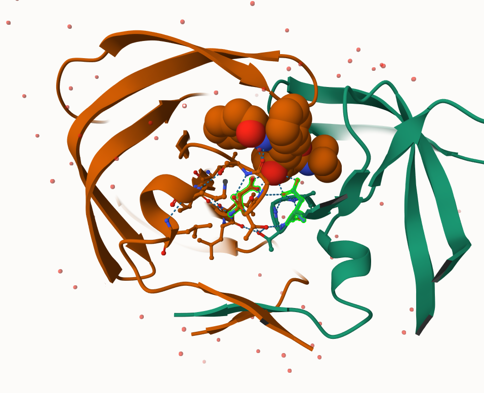

# PDB Statistics

```{r}
# Read the PDB statistics CSV file
pdb <- read.csv("pdb_stats.csv")

# Display the data
pdb

# Calculate the total number of structures
total_structures <- sum(pdb$Total)

total_structures
```

## Q1. What percentage of structures in the PDB are solved by X-Ray and Electron Microscopy?

```{r}
# Calculate the total number of X-ray structures
xray_total <- sum(pdb$X.ray)

# Calculate the total number of EM structures
em_total <- sum(pdb$EM)

# Calculate percentages
xray_percent <- xray_total / total_structures * 100
em_percent <- em_total / total_structures * 100

# Display results
round(xray_percent, 2)
round(em_percent, 2)
```

**Answer:**

According to the PDB statistics from February 6, 2026, approximately 80.95% of structures were determined using X-ray crystallography, while 12.84% were determined using Electron Microscopy.

## Q2. What proportion of structures in the PDB are protein?

```{r}
# Extract the number of protein-only structures
protein_total <- pdb$Total[
  pdb$Molecular.Type == "Protein (only)"
]

# Calculate the proportion
protein_proportion <- protein_total / total_structures

# Convert the proportion to a percentage
protein_percent <- protein_proportion * 100

# Display results
round(protein_proportion, 4)
round(protein_percent, 2)
```

**Answer:**

The proportion of protein-only structures in the PDB is approximately 0.8597, corresponding to 85.97% of all structures.


## Q3. How many HIV-1 protease structures are in the current PDB?

```{r}
# Number of HIV-1 protease structures in the PDB
hiv_protease_count <- 1128

# Display the result
hiv_protease_count
```

**Answer:**

According to the RCSB Protein Data Bank (PDB), there are 1,128 HIV-1 protease structures in the database based on the search results.


# Visualizing the HIV-1 Protease Structure

## Q4. Water molecules normally have 3 atoms. Why do we see just one atom per water molecule in this structure?

**Answer:**

Only the oxygen atom of each water molecule is shown because hydrogen atoms have very low electron density and are difficult to resolve using X-ray crystallography at this resolution. Therefore, only the oxygen positions are included in the structure.

## Q5. There is a critical "conserved" water molecule in the binding site. Can you identify this water molecule? What residue number does this water molecule have?

**Answer:**

The conserved water molecule is HOH 308 in chain B (residue number 308). It is located in the binding site and helps stabilize interactions between the inhibitor and HIV-1 protease through hydrogen bonding.


## Q6. Generate and save a figure showing the HIV-1 protease structure.

**Answer:**

The figure below shows the 3D structure of HIV-1 protease (PDB ID: 1HSG), which consists of two identical protein chains (A and B). The inhibitor indinavir is bound at the active site between the two chains. The catalytic residues Asp25 from both chains are important for protease activity.

{#fig-hiv-protease width="85%"}


# Introduction to Bio3D in R

## Reading PDB File Data into R

```{r}
# Load the Bio3D package
library(bio3d)

# Read the HIV-1 protease structure (PDB ID: 1HSG)
pdb <- read.pdb("1hsg")

# Display a summary of the PDB structure
pdb

# Examine the attributes of the PDB object
attributes(pdb)

# Display the first six rows of atomic data
head(pdb$atom)
```

## Q7. How many amino acid residues are there in this PDB object?

```{r}
# Count the number of amino acid residues
# Each amino acid residue has one alpha carbon (CA)
amino_acid_residues <- sum(
  pdb$atom$type == "ATOM" &
  pdb$atom$elety == "CA"
)

# Display the result
amino_acid_residues
```

**Answer:**

There are 198 amino acid residues in this PDB structure, with 99 residues in each of the two protein chains.

## Q8. Name one of the two non-protein residues.

```{r}
# Identify the non-protein residue types
non_protein_residues <- unique(
  pdb$atom$resid[pdb$atom$type == "HETATM"]
)

# Display the non-protein residues
non_protein_residues
```

**Answer:**

One non-protein residue is HOH (water). The other is MK1 (indinavir), an inhibitor bound to HIV-1 protease.

## Q9. How many protein chains are in this structure?

```{r}
# Identify the protein chains
protein_chains <- unique(
  pdb$atom$chain[pdb$atom$type == "ATOM"]
)

# Count the number of protein chains
number_of_chains <- length(protein_chains)

# Display the chain identifiers
protein_chains

# Display the total number of chains
number_of_chains
```

**Answer:**

There are two protein chains in this structure, identified as chain A and chain B. Together, they form the HIV-1 protease homodimer.


# Comparative Structure Analysis of Adenylate Kinase

## Q10. Which of the packages above is found only on Bioconductor and not CRAN?

**Answer:**

The msa package is available through Bioconductor rather than CRAN. It is used for multiple sequence alignment.

## Q11. Which of the above packages is not found on Bioconductor or CRAN?

**Answer:**

The bio3dview package is not available on Bioconductor or CRAN. It can be installed directly from GitHub.

## Q12. True or False? Functions from the pak package can be used to install packages from GitHub and BitBucket?

**Answer:**

True. The pak package can install R packages from GitHub and from Bitbucket through Git repository URLs.

## Q13. How many amino acids are in this sequence, i.e. how long is this sequence?

```{r}
# Load the Bio3D package
library(bio3d)
library(httr)

# Retrieve the amino acid sequence of Adenylate Kinase
# PDB ID: 1AKE, Chain A
aa <- get.seq("1ake_A")

# Display the sequence
aa

# Calculate the sequence length
sequence_length <- ncol(aa$ali)

# Display the result
sequence_length
```

**Answer:**

The adenylate kinase sequence from PDB ID 1AKE, chain A, contains 214 amino acids.


# Comparative Structure Analysis of Adenylate Kinase 

## 1. Retrieve ADK Structures


```{r}
# Load required packages
library(bio3d)
library(msa)

# Define the 13 ADK structures
hits <- list(
  pdb.id = c(
    "1AKE_A", "6S36_A", "6RZE_A",
    "3HPR_A", "1E4V_A", "5EJE_A",
    "1E4Y_A", "3X2S_A", "6HAP_A",
    "6HAM_A", "4K46_A", "3GMT_A",
    "4PZL_A"
  )
)

# Display the PDB IDs
hits$pdb.id

# Number of structures
length(hits$pdb.id)
```

**Result:**

A total of 13 adenylate kinase structures were selected for comparative analysis.

```{r}
# Download the PDB files
files <- get.pdb(
  hits$pdb.id,
  path = "pdbs",
  split = TRUE,
  gzip = TRUE
)

# Display the downloaded files
files
```

## 2. Align and Superpose ADK Structures


```{r}
# Align and superpose the PDB structures
pdbs <- pdbaln(
  files,
  fit = TRUE,
  exefile = "msa"
)

# Display the aligned structure data
pdbs

# Extract PDB identifiers
ids <- basename.pdb(pdbs$id)

# Display the identifiers
ids
```

**Interpretation:**

The ADK structures were aligned and superposed to establish corresponding residue positions. This allows us to compare their three-dimensional conformations and identify regions of structural variation.

## 3. Annotate the Collected PDB Structures

```{r}
# Retrieve structural annotations
anno <- tryCatch(
  pdb.annotate(ids),
  error = function(e) {
    message("Annotation request failed: ", conditionMessage(e))
    NULL
  }
)

# Display source organisms
if (!is.null(anno)) {
  unique(anno$source)
} else {
  cat("Annotation data could not be retrieved.")
}
```

**Interpretation:**

Structural annotation provides information about the source organisms of the collected proteins. This information helps us understand the biological diversity of the structures included in the analysis.

## 4. Principal Component Analysis (PCA)


```{r}
# Perform PCA
pc.xray <- pca(pdbs)

# Plot the PCA results
plot(pc.xray)
```

**Interpretation:**

PCA identifies the principal directions of structural variation among the ADK structures. Each point represents a protein structure, and the separation between points reflects differences in their conformations. The first two principal components capture major patterns of variation within the structural ensemble.

## 5. RMSD and Structural Clustering


```{r}
# Calculate pairwise RMSD values
rd <- rmsd(pdbs)

# Display RMSD matrix
round(rd, 2)

# Perform hierarchical clustering
hc.rd <- hclust(dist(rd))

# Divide structures into three groups
grps.rd <- cutree(hc.rd, k = 3)

# Plot PCA results colored by cluster
plot(
  pc.xray,
  1:2,
  col = "grey50",
  bg = grps.rd,
  pch = 21,
  cex = 1
)
```

**Interpretation:**

RMSD analysis quantifies the structural differences among the ADK proteins. Hierarchical clustering groups structures with similar patterns of structural deviation. The PCA plot highlights conformational differences among these groups. Three groups were specified for this analysis.

## 6. PCA Visualization


```{r}
# Generate a structural trajectory along PC1
pc1 <- mktrj(
  pc.xray,
  pc = 1,
  file = "pc_1.pdb"
)

# Confirm that the trajectory file was created
file.exists("pc_1.pdb")
```

**Interpretation:**

The generated trajectory illustrates structural changes along the first principal component. These changes represent the dominant conformational variation observed among the ADK structures and may be related to movements involved in enzyme function.

## 7. PCA Visualization Using ggplot2

```{r}
# Load plotting packages
library(ggplot2)
library(ggrepel)

# Create a data frame of PCA results
df <- data.frame(
  PC1 = pc.xray$z[, 1],
  PC2 = pc.xray$z[, 2],
  col = as.factor(grps.rd),
  ids = ids
)

# Generate the PCA scatter plot
p <- ggplot(df, aes(
  x = PC1,
  y = PC2,
  color = col,
  label = ids
)) +
  geom_point(size = 2) +
  geom_text_repel(max.overlaps = 20) +
  labs(
    title = "PCA of Adenylate Kinase Structures",
    x = "Principal Component 1",
    y = "Principal Component 2",
    color = "Cluster"
  ) +
  theme_minimal()

# Display the plot
p
```

**Interpretation:**

The PCA scatter plot visualizes the conformational variability of the 13 ADK structures. Structures positioned close together have similar projections onto the first two principal components, while those farther apart show greater differences along these axes.


# Session Information

```{r}
sessionInfo()
```


