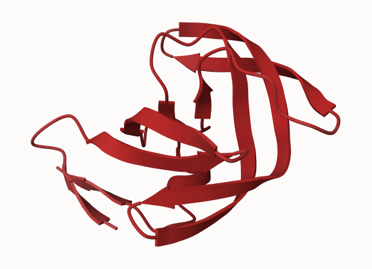

# AlphaFold Database Search

## Search Results

The HIV-1 protease sequence was searched against the AlphaFold Protein Structure Database.

The matching result was Gag-Pol polyprotein (UniProt ID: P04585) from Human immunodeficiency virus 1. The predicted structure corresponds to a 99-amino-acid protease region.

The sequence alignment showed 99% identity and 100% coverage, with an E-value of 2.12292e-66.

The predicted structure had an average pLDDT score of 96.78, indicating very high local structural confidence.

## Interpretation

The high sequence identity suggests that the predicted structure is highly relevant to the HIV-1 protease sequence used in this experiment. The high pLDDT indicates strong confidence in the local protein structure, although it does not guarantee the accuracy of the complete biological complex.

{width="70%"}


# ColabFold Structure Prediction

## Prediction Method

The HIV-1 protease sequence was used for structure prediction with ColabFold.

A monomer model was generated using a single 99-amino-acid sequence. A homodimer was modeled using two identical sequences separated by a colon, giving a total of 198 amino acids.

## Structural Visualization

The predicted structures were visualized using Mol*. The models were superposed to compare their three-dimensional conformations and identify regions of structural variability.


# Structural Visualization Using Mol*

The predicted HIV-1 protease structure was downloaded from the AlphaFold Protein Structure Database and visualized using Mol*.

The protein was displayed using the cartoon representation and colored according to its predicted local confidence (pLDDT), which is stored in the B-factor field of the PDB file.

{#fig-molstar width="80%"}

The model represents a single protease chain. Although the predicted structure has a high average pLDDT score, the functional HIV-1 protease is a homodimer. Therefore, this monomer prediction does not by itself establish the accuracy of the biologically active dimer interface.


# Structural Analysis Using Bio3D

## Reading the Predicted Structure

```{r}
# Load the Bio3D package
library(bio3d)

# Read the downloaded AlphaFold structure
af <- read.pdb("hiv_protease_afdb.pdb")

# Display a summary of the structure
af

# Examine the first six atoms
head(af$atom)
```

## Protein Length and Residue Information

```{r}
# Select alpha-carbon (CA) atoms
ca <- af$atom[
  af$atom$type == "ATOM" &
  af$atom$elety == "CA",
]

# Number of amino acid residues
num_residues <- nrow(ca)

# Display the result
num_residues

# Examine residue information
head(ca[, c("resno", "resid", "b")])
```

**Answer:**

The predicted HIV-1 protease monomer contains 99 amino acid residues. The alpha-carbon atoms were selected for residue-level structural analysis.

## Analysis of pLDDT Confidence Scores


```{r}
# Extract per-residue pLDDT scores
plddt <- as.numeric(ca$b)

# Calculate summary statistics
mean_plddt <- mean(plddt, na.rm = TRUE)
min_plddt <- min(plddt, na.rm = TRUE)
max_plddt <- max(plddt, na.rm = TRUE)

# Display results
mean_plddt
min_plddt
max_plddt

# Calculate the number of low-confidence residues
low_confidence <- sum(plddt < 70, na.rm = TRUE)

low_confidence
```

**Answer:**

The mean per-residue pLDDT score calculated from the downloaded model is `r round(mean_plddt, 2)`. The scores range from `r round(min_plddt, 2)` to `r round(max_plddt, 2)`.

A total of `r low_confidence` residues have pLDDT scores below 70.

Higher pLDDT scores indicate greater confidence in the predicted local structure, while lower scores indicate greater uncertainty.

## Per-Residue pLDDT Visualization

```{r}
# Plot the pLDDT confidence profile
plot(
  ca$resno,
  plddt,
  type = "l",
  lwd = 2,
  col = "blue",
  ylim = c(0, 100),
  xlab = "Residue Position",
  ylab = "pLDDT Score",
  main = "Per-Residue pLDDT of HIV-1 Protease"
)

# Add confidence thresholds
abline(h = 90, col = "darkgreen", lty = 2)
abline(h = 70, col = "orange", lty = 2)
abline(h = 50, col = "red", lty = 2)

# Add legend
legend(
  "bottomleft",
  legend = c(
    "pLDDT",
    "Very high confidence (90)",
    "Confident (70)",
    "Low confidence (50)"
  ),
  col = c("blue", "darkgreen", "orange", "red"),
  lty = c(1, 2, 2, 2),
  cex = 0.7
)
```

**Interpretation:**

The pLDDT profile shows the predicted confidence at each amino acid position. The graph can be used to identify locally uncertain regions that may require more cautious structural interpretation.

High confidence in the monomer does not necessarily imply high confidence in the assembly of the functional HIV-1 protease homodimer.
